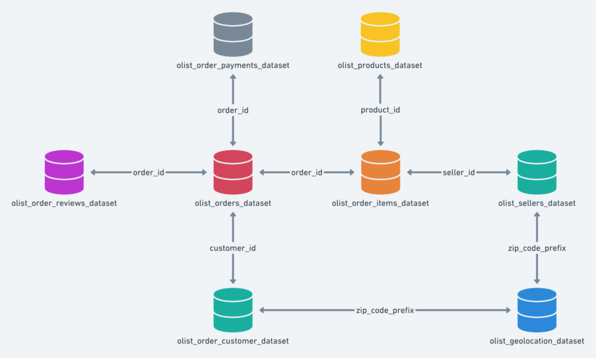

<h1>olist-pro</h1>

<h3>تحلیل داده‌های فروش و رفتار مشتریان فروشگاه اینترنتی Olist</h3>

---

## معرفی پروژه

در این پروژه قرار است در نقش یک تحلیلگر داده (<bdi dir="ltr">Data Analyst</bdi>) برای یک پلتفرم تجارت الکترونیک فعالیت کنیم.

داده‌های مورد استفاده در این پروژه مربوط به <bdi dir="ltr">Olist</bdi>، یک پلتفرم تجارت الکترونیک در برزیل است. این پلتفرم بستری فراهم می‌کند که فروشندگان مختلف بتوانند محصولات خود را از طریق فروشگاه‌های آنلاین به مشتریان سراسر برزیل عرضه کنند.

در طول فعالیت این پلتفرم، حجم زیادی از اطلاعات درباره سفارش‌ها، مشتریان، محصولات، فروشندگان، پرداخت‌ها، ارسال سفارش‌ها و نظرات مشتریان ثبت شده است.

اما وجود داده به‌تنهایی برای یک کسب‌وکار ارزش چندانی ندارد. ارزش واقعی زمانی ایجاد می‌شود که بتوانیم از این داده‌ها برای پاسخ دادن به سؤالات کسب‌وکاری استفاده کنیم.

در این پروژه تلاش خواهیم کرد با استفاده از داده‌های واقعی، از داده خام به اطلاعات، الگوها و در نهایت بینش کسب‌وکاری (<bdi dir="ltr">Business Insight</bdi>) برسیم.

## هدف پروژه

فرض کنید به‌تازگی به تیم تحلیل داده <bdi dir="ltr">Olist</bdi> پیوسته‌اید و مدیران شرکت از شما خواسته‌اند داده‌های موجود را بررسی کرده و تصویری کلی از وضعیت کسب‌وکار ارائه دهید.

در پایان پروژه باید بتوانید به مدیریت توضیح دهید:

- کسب‌وکار در چه وضعیتی قرار دارد؟
- مشتریان چگونه رفتار می‌کنند؟
- چه بخش‌هایی عملکرد خوبی دارند؟
- چه بخش‌هایی ممکن است نیاز به بررسی بیشتری داشته باشند؟

## مهارت‌ها و مباحث مورد بررسی

تمرکز اصلی پروژه بر یادگیری و تمرین موارد زیر است:

- پاک‌سازی و آماده‌سازی داده‌ها
- کار با چند <bdi dir="ltr">DataFrame</bdi>
- ترکیب جداول با یکدیگر
- استفاده از <bdi dir="ltr">groupby</bdi> و <bdi dir="ltr">Aggregation</bdi>
- کار با داده‌های زمانی
- استخراج شاخص‌های کسب‌وکار
- تحلیل رفتار مشتریان
- استفاده از کتابخانه <bdi dir="ltr">Pandas</bdi> برای تحلیل داده
- انتخاب نمودار مناسب برای نمایش داده‌ها
- رسم نمودار با کتابخانه‌های <bdi dir="ltr">Matplotlib</bdi> و <bdi dir="ltr">Seaborn</bdi>
- تفسیر نمودارها و نتایج حاصل از تحلیل
- استخراج بینش‌های کسب‌وکاری (<bdi dir="ltr">Business Insights</bdi>)

## ساختار دیتابیس

تصویر زیر ساختار کلی جداول دیتاست Olist و ارتباط میان آن‌ها را نشان می‌دهد.

## مستندات پروژه

برای مشاهده شرح کامل مراحل تحلیل، سؤالات دوره و الزامات تحویل پروژه، به مستندات زیر مراجعه کنید:

[مشاهده صورت‌مسئله و نیازمندی‌های کامل پروژه](docs/project_requirements.md)

