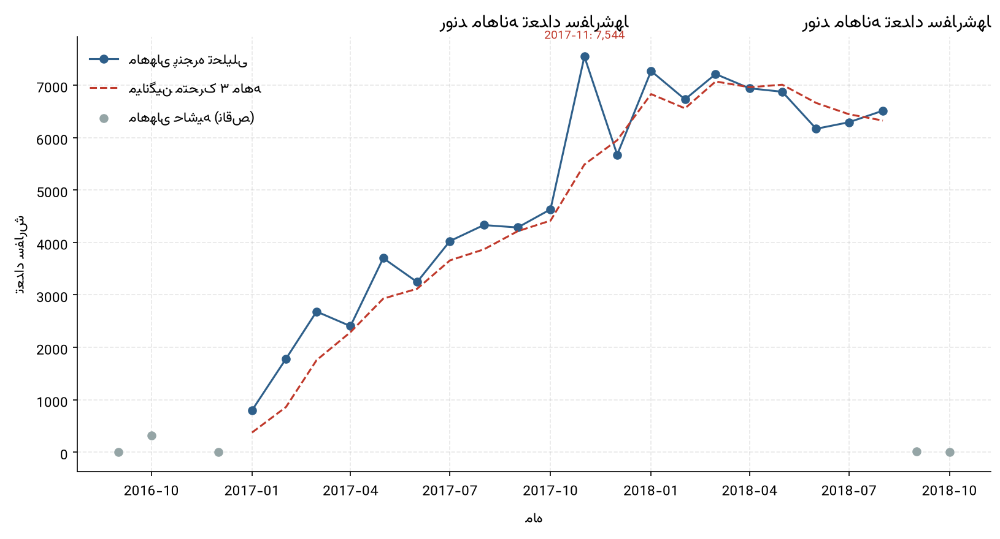
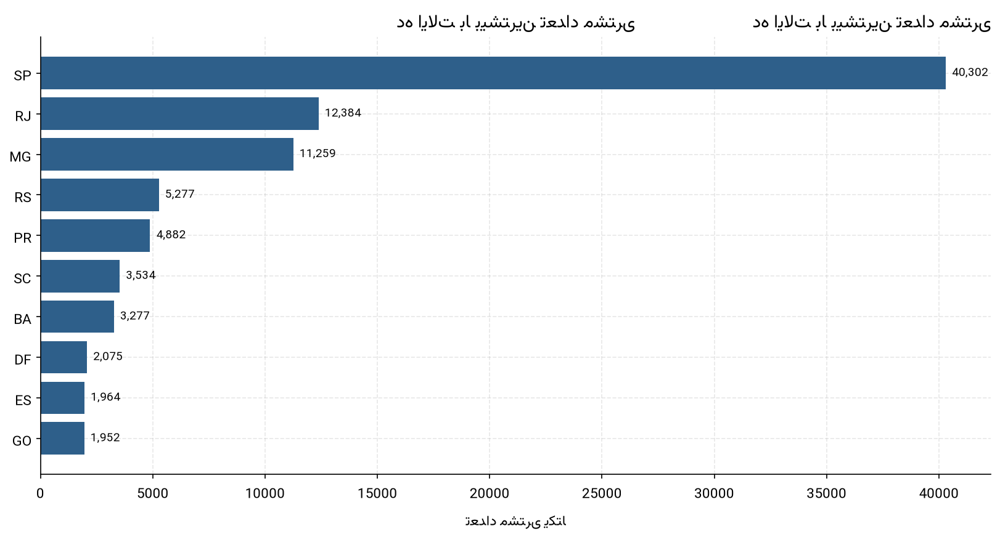
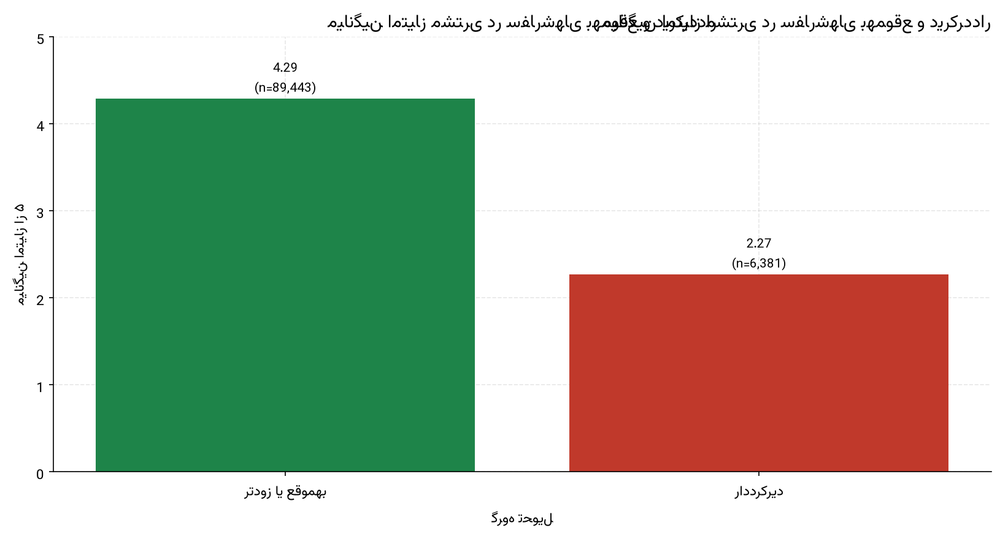
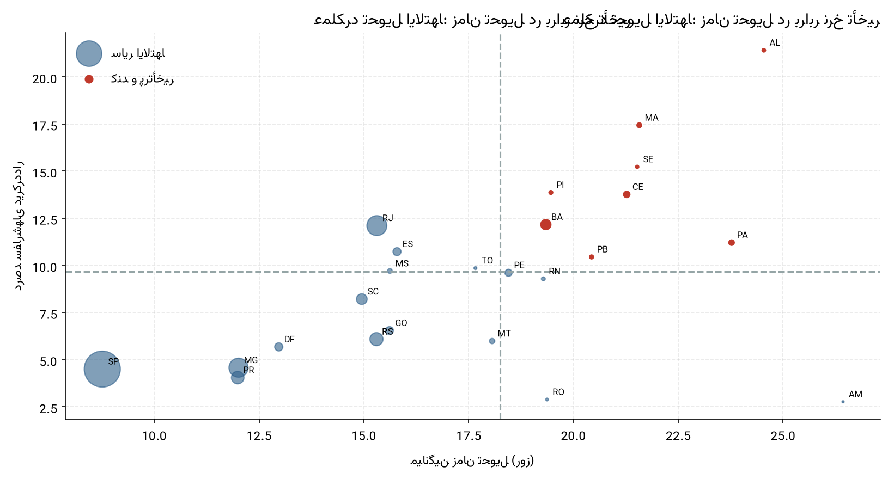
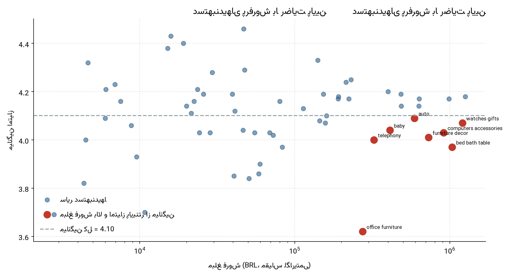

# گزارش مدیریتی تحلیل دادههای فروش و رفتار مشتریان Olist

این گزارش بر پایه تحلیل داده واقعی سفارشهای Olist (۹۹٬۴۴۱ سفارش بین سپتامبر ۲۰۱۶ تا اکتبر ۲۰۱۸) تهیه شده است و برای مخاطب مدیریتی نوشته شده؛ بنابراین هیچ کد برنامهنویسی در آن وجود ندارد.

> شماره اجرا: همه اعداد این گزارش از فایل `reports/metrics.json` و جداول `reports/tables/` همان اجرای خط لوله خوانده شدهاند.

## ۱. خلاصه اجرایی

- در بازه مورد بررسی 99,441 سفارش ثبت شده است که 96,478 مورد آن، یعنی حدود 97.02 درصد، به وضعیت «تحویلشده» رسیدهاند.
- ارزش اقلام فروختهشده 13,591,643.70 رئال برزیل و مجموع مبلغ پرداختشده 16,008,872.12 رئال است؛ اختلاف این دو عدد عمدتاً از هزینه ارسال (2,251,909.54 رئال) و ساختار پرداخت ناشی میشود. این مبلغ «ارزش اقلام سفارشها» است و با سود خالص شرکت یکسان نیست.
- مجموعه شامل 96,096 خریدار یکتا، 32,951 محصول در 73 دستهبندی و 3,095 فروشنده است.
- میانگین زمان تحویل 12.56 روز و میانه آن 10.22 روز است؛ فاصله میان میانگین و میانه نشان میدهد توزیع زمان تحویل چوله به راست است و تعداد محدودی سفارش بسیار طولانی، میانگین را بالا میبرد.
- میانگین امتیاز مشتریان 4.0864 از ۵ است؛ 77.07 درصد نظرات امتیاز ۴ یا ۵ و 14.69 درصد امتیاز ۱ یا ۲ گرفتهاند.
- نرخ سفارشهای دیرکرددار 6.77 درصد از سفارشهای تحویلشده (6,534 سفارش) است، در حالی که 72.66 درصد سفارشها حداکثر تا ۱۵ روز تحویل شدهاند.

## ۲. وضعیت کلی کسبوکار

کسبوکار Olist در پنجره تحلیلی از یک پلتفرم در حال راهاندازی به یک عملیات تثبیتشده تبدیل شده است. تقاضا در سال ۲۰۱۷ سریع رشد کرده، در ۲۰۱۸ در سطح بالاتری تثبیت شده و الگوی فصلی روشنی ندارد. رضایت مشتریان در مجموع بالا است، اما بخش کوچکی از سفارشها که با تأخیر تحویل میشوند، امتیاز بسیار پایینتری ثبت میکنند.

## ۳. پنج یافته مهم

### یافته 1: رشد سریع کسبوکار در ۲۰۱۷ و سپس تثبیت در سطح بالاتر در ۲۰۱۸

**نتیجه:** حجم سفارشها از آغاز فعالیت رشد چشمگیری داشته است، اما این رشد یکنواخت نبوده؛ پس از جهش آبان ۲۰۱۷ و فروردین ۲۰۱۸، سطح فعالیت تقریباً ثابت شده و الگوی فصلی قابل تشخیصی نیز دیده نمیشود.

**شواهد عددی:**

- تعداد سفارشها از 800 در 2017-01 به اوج 7,544 در 2017-11 رسیده است.
- مقایسه همدوره ژانویه تا اوت: 22,968 سفارش در ۲۰۱۷ برابر با 53,991 سفارش در ۲۰۱۸، یعنی 135.07 درصد افزایش.
- میانگین سفارش ششماهه نخست پنجره تحلیلی 2,435.2 و ششماهه پایانی 6,665.7 سفارش در ماه است.
- سه ماه پایانی پنجره بهطور میانگین 6,323.7 سفارش در ماه دارد، در برابر 2,435.2 سفارش در شش ماه نخست این پنجره.

*روند ماهانه سفارشها همراه با میانگین متحرک ۳ ماهه*

**اهمیت کسبوکاری:** برنامهریزی ظرفیت انبار، پشتیبانی و ارسال باید بر پایه سطح فعلی تقاضا انجام شود، نه بر پایه نرخ رشد ۲۰۱۷. همچنین نبود الگوی فصلی روشن یعنی نمیتوان برای کمپینها به «فصل اوج» تکیه کرد.

**محدودیت:** مقایسه همدوره، یک سال راهاندازی را با یک سال تثبیتشده میسنجد و بنابراین درصد رشد را بیش از حد نشان میدهد. ماههای ۲۰۱۶ و دو ماه پایانی ۲۰۱۸ بهدلیل ناقص بودن از تحلیل روند کنار گذاشته شدهاند.

### یافته 2: تمرکز شدید بازار در پنج ایالت و یک شهر

**نتیجه:** بازار Olist بهشدت متمرکز است: نزدیک به نیمی از خریداران در یک ایالت و بیش از سهچهارم آنان در پنج ایالت زندگی میکنند.

**شواهد عددی:**

- 96,096 خریدار یکتا در 27 ایالت شناسایی شده است.
- پنج ایالت نخست (SP, RJ, MG, RS, PR) روی هم 77.08 درصد خریداران و 77.18 درصد سفارشها را در اختیار دارند.
- ایالت SP بهتنهایی نامشخص درصد خریداران را دارد (این عدد از جدول 06_customers_by_state خوانده میشود).
- سهم ایالتها از مشتریان و از سفارشها تقریباً یکسان است؛ یعنی اختلاف معناداری میان «تعداد مشتری» و «حجم سفارش» در سطح ایالتها وجود ندارد.

*ده ایالت نخست بر اساس تعداد مشتری یکتا*

**اهمیت کسبوکاری:** تمرکز بالا هم مزیت است (کارایی لجستیک و بازاریابی در مناطق پرتراکم) و هم ریسک (وابستگی به یک بازار). رشد پایدار در میانمدت به تنوعبخشی بازار نیاز دارد.

**محدودیت:** داده شامل هزینه بازاریابی، رقبا یا تقاضای بالفعل مناطق کممشتری نیست. بنابراین تعداد کم مشتری در یک ایالت بهتنهایی نشانه فرصت رشد نیست و بهعنوان فرصت اثباتشده معرفی نمیشود.

### یافته 3: تأخیر در تحویل، قویترین عامل همراه با افت رضایت مشتری

**نتیجه:** سفارشهای دیرکرددار بخش کوچکی از سفارشها را تشکیل میدهند، اما میانگین امتیاز آنان بسیار پایینتر است؛ و هرچه تأخیر طولانیتر باشد، افت امتیاز شدیدتر میشود.

**شواهد عددی:**

- 6.77 درصد از سفارشهای تحویلشده (6,534 سفارش) با تأخیر تحویل شدهاند.
- میانگین امتیاز گروه بهموقع یا زودتر 4.29 و گروه دیرکرددار 2.27 است؛ اختلاف 2.02 امتیاز.
- در بازه بیش از ۷ روز تأخیر، میانگین امتیاز به 1.70 کاهش مییابد و 79.29 درصد این سفارشها امتیاز ۱ یا ۲ گرفتهاند.
- میانگین روزهای تأخیر میان سفارشهای دیرکرددار 10.62 روز است و 2,862 سفارش بیش از هفت روز تأخیر داشتهاند.

*میانگین امتیاز مشتری در سفارشهای بهموقع و دیرکرددار*

**اهمیت کسبوکاری:** این یافته کمهزینهترین مسیر بهبود رضایت است: کاهش تأخیر در چند هزار سفارش، میانگین امتیاز کل را مستقیماً بالا میبرد. امتیاز پایین همچنین بر نرخ بازگشت مشتری و اعتبار فروشگاه اثر میگذارد.

**محدودیت:** این یک رابطه مشاهدهشده است، نه اثبات علیت. ممکن است تأخیر و امتیاز پایین هر دو ناشی از عوامل مشترکی مانند ناموجود بودن کالا یا مشکل فروشنده باشند. برای استنباط علّی به داده آزمایشی یا اطلاعات علت تأخیر نیاز است.

### یافته 4: تأخیر در تحویل الگویی منطقهای دارد، نه تصادفی

**نتیجه:** زمان تحویل و نرخ تأخیر در ایالتهای شمال و شمالشرق بهطور نظاممند بدتر از ایالتهای جنوب و جنوبشرق است؛ یعنی مسئله بیشتر عملیاتی و منطقهای است تا عمومی.

**شواهد عددی:**

- 8 ایالت همزمان در هر دو شاخص «زمان تحویل» و «نرخ تأخیر» بالاتر از میانه قرار گرفتند: AL، MA، SE، PI، CE، BA، PA، PB.
- بدترین ایالت AL با 24.54 روز میانگین تحویل و 21.41 درصد نرخ تأخیر است.
- در مقابل، ایالت SP با 8.76 روز میانگین تحویل و 4.49 درصد نرخ تأخیر، بهترین عملکرد را دارد.

*عملکرد تحویل ایالتها: زمان تحویل در برابر نرخ تأخیر*

**اهمیت کسبوکاری:** اقدام لجستیکی میتواند هدفمند باشد: تمرکز روی چند ایالت مشخص، بهجای یک برنامه سراسری پرهزینه. همچنین میتوان وعده تحویل را در همین ایالتها محافظهکارانهتر تنظیم کرد.

**محدودیت:** بخشی از تفاوت، ناشی از فاصله جغرافیایی است و در داده فعلی سهم هر علت قابل تفکیک نیست. همچنین وعده تحویل در این ایالتها از پیش طولانیتر است، پس بخشی از میانگین بلندتر، نتیجه حاشیه امن عمدی است و نه فقط کندی عملیات.

### یافته 5: سهم بالای چند دستهبندی در فروش، همراه با نقاط ضعف کیفی مشخص

**نتیجه:** پنج دستهبندی نخست بیش از ۴۰ درصد ارزش فروش را تشکیل میدهند. در همین گروه، چند دستهبندی و فروشنده با فروش بالا امتیاز پایینتر از میانگین دارند.

**شواهد عددی:**

- پنج دستهبندی نخست 40.27 درصد از کل مبلغ فروش (5,400,678.99 رئال) را تشکیل میدهند.
- مورد شاخص در سطح دستهبندی: office_furniture با مبلغ فروش 273,960.70 رئال، 1,263 نظر و میانگین امتیاز 3.62 (اختلاف -0.48 با میانگین کل).
- مورد شاخص در سطح فروشنده: فروشنده 1ca7077d890b با مبلغ فروش 13,341.57 رئال، 114 نظر و میانگین امتیاز 2.33.
- ده فروشنده نخست روی هم 13.15 درصد مبلغ فروش را در اختیار دارند؛ تمرکز فروش عمدتاً در سطح دستهبندی است، نه فروشنده.

*دستهبندیهای پرفروش با میانگین امتیاز پایینتر از میانگین کل*

**اهمیت کسبوکاری:** دستهبندیها و فروشندگانی که هم پولساز هستند و هم رضایت پایین دارند، بالاترین اولویت بررسی کیفی را دارند: ریسک مالی آنان بزرگتر از سایرین است.

**محدودیت:** امتیاز پایین ممکن است ناشی از ماهیت کالا، انتظار خریدار یا کیفیت بستهبندی باشد و داده فعلی علت را مشخص نمیکند. امتیاز دستهبندیهای کمحجم نیز بهدلیل نمونه کوچک قابل تعمیم نیست.

## ۴. سه پیشنهاد عملی

### پیشنهاد 1: کاهش تأخیر تحویل در 8 ایالت دارای وضعیت نامطلوب

- **مسئله:** 6.77 درصد سفارشهای تحویلشده دیرکرددار هستند و در ایالتهای شمال و شمالشرق این نرخ چند برابر ایالتهای جنوب و جنوبشرق است.
- **یافته پشتیبان:** یافته ۳ و ۴: اختلاف 2.02 امتیازی میان دو گروه تحویل، و نرخ تأخیر 21.41 درصد در AL.
- **تغییر مورد انتظار:** کاهش نرخ تأخیر و در پی آن افزایش میانگین امتیاز سفارشهای همان ایالتها؛ حتی کاهش چند درصدی سهم سفارشهای دیرکرددار میتواند میانگین امتیاز کل را بهطور محسوس بالا ببرد.
- **شاخصهای پایش:**
  - نرخ سفارشهای دیرکرددار به تفکیک ایالت (ماهانه)
  - میانگین روزهای تأخیر در میان سفارشهای دیرکرددار
  - میانگین امتیاز سفارشهای دیرکرددار در برابر بهموقع

### پیشنهاد 2: بازتنظیم وعده تحویل بر اساس عملکرد واقعی هر منطقه

- **مسئله:** بهطور میانگین سفارشها 11.18 روز زودتر از وعده اعلامشده تحویل میشوند؛ یعنی وعده فعلی در کل حاشیه امن بزرگی دارد و در برخی مناطق بیش از حد محافظهکارانه است.
- **یافته پشتیبان:** یافته ۴: میانگین زمان تحویل در AL 24.54 روز است، در حالی که وعده اعلامی برای همان ایالت طولانیتر است (جدول 09_delivery_by_state).
- **تغییر مورد انتظار:** اعلام وعدههای واقعبینانهتر میتواند نرخ تبدیل را بهبود دهد؛ در نقاطی که حاشیه امن غیرضروری وجود دارد بدون افزایش نرخ تأخیر، و در ایالتهای پرتأخیر با حاشیه بیشتر.
- **شاخصهای پایش:**
  - میانگین و میانه روزهای زودتر از وعده در هر ایالت
  - نرخ تأخیر به تفکیک ایالت پس از تغییر وعدهها
  - نرخ تبدیل سفارش در ایالتهایی که وعده تغییر کرده است

### پیشنهاد 3: بازبینی کیفی دستهبندیها و فروشندگان پرفروش با امتیاز پایین

- **مسئله:** بخشی از پرفروشترین دستهبندیها و فروشندگان، میانگین امتیاز پایینتر از میانگین کل دارند؛ این ترکیب، هم ریسک از دست دادن مشتری و هم ریسک اعتبار فروشگاه ایجاد میکند.
- **یافته پشتیبان:** یافته ۵: office_furniture با مبلغ فروش 273,960.70 رئال، 1,263 نظر و میانگین امتیاز 3.62 (اختلاف -0.48 با میانگین کل) و فروشنده 1ca7077d890b با مبلغ فروش 13,341.57 رئال، 114 نظر و میانگین امتیاز 2.33.
- **تغییر مورد انتظار:** شناسایی علت اصلی (کیفیت کالا، تأخیر، بستهبندی یا توصیف نامنطبق) در همان دستهبندیها و فروشندگان و افزایش تدریجی میانگین امتیاز آنان به سطح میانگین کل.
- **شاخصهای پایش:**
  - میانگین امتیاز هر دستهبندی با حداقل ۳۰ نظر
  - سهم نظرات با امتیاز ۱ یا ۲ در دستهبندیها و فروشندگان پرچمخورده
  - نرخ خرید دوباره مشتریان (سهم خریداران با بیش از یک سفارش)

> این پیشنهادها مبتنی بر شواهد داده موجود هستند و بهعنوان نتیجه اثباتشده یا تضمینشده ارائه نمیشوند.

## ۵. شاخصهای پیشنهادی برای پایش آینده

| شاخص | تعریف |
| --- | --- |
| نرخ سفارشهای دیرکرددار | درصد سفارشهای تحویلشده با تأخیر بیشتر از تاریخ تخمینی |
| میانگین زمان تحویل | میانگین فاصله ثبت سفارش تا تحویل واقعی، به تفکیک ایالت |
| میانگین امتیاز مشتری | میانگین review_score و سهم امتیازهای ۱ و ۲ |
| سهم امتیازهای ۱ و ۲ در سفارشهای دیرکرددار | بهعنوان شاخص هشدار زودهنگام تجربه مشتری |
| سهم خریداران بازگشتی | درصد خریداران با بیش از یک سفارش (اکنون 3.12 درصد) |
| سهم پنج دستهبندی نخست از مبلغ فروش | برای پایش تمرکز درآمد |
| سهم پنج ایالت نخست از سفارشها | برای پایش تمرکز بازار |

## ۶. محدودیتهای اصلی تحلیل

- همه یافتهها همبستگی توصیفی هستند؛ هیچ آزمون علّی یا آزمایش کنترلشدهای انجام نشده است.
- مبلغ فروش از ستون price جدول اقلام سفارش محاسبه شده و با درآمد خالص یا سود شرکت یکسان نیست.
- سفارشهای لغوشده و ناموجود در تحلیلهای تحویل و رضایت وارد نشدهاند؛ بنابراین نتایج آن تحلیلها فقط برای سفارشهای تحویلشده معتبر است.
- ماههای سال ۲۰۱۶ و دو ماه پایانی سال ۲۰۱۸ از تحلیل روند کنار گذاشته شدهاند؛ اما آمار کل بر پایه همه داده است.
- متن نظرات مشتریان در تحلیل کمّی استفاده نشده است؛ 58.70 درصد نظرات هیچ متن توضیحی ندارند.
- داده شامل هزینه بازاریابی، موجودی انبار، رقبا و اطلاعات جمعیتشناختی مشتریان نیست.

## ۷. جمعبندی

دادههای Olist نشان میدهند مسئله اصلی کسبوکار کمبود تقاضا نیست، بلکه «پایداری تجربه تحویل» است. حجم سفارشها رشد کرده و تثبیت شده است، بازار متمرکز است و رضایت کلی بالا؛ اما همان بخش کوچکی از سفارشها که با تأخیر تحویل میشوند، بخش بزرگی از نارضایتی را تولید میکنند و تأخیر در چند ایالت مشخص متمرکز است. تمرکز اقدام بر همین نقاط، کمهزینهترین مسیر بهبود شاخصهای مشتری است.

## پیوست: فهرست نمودارها

- `figures/fig_01_order_status.png` - نمودار ۱ - توزیع سفارشها بر اساس وضعیت (n=99,441)
- `figures/fig_02_monthly_orders.png` - نمودار ۲ - روند ماهانه سفارشها؛ ماههای حاشیه از تحلیل روند کنار گذاشته شدهاند
- `figures/fig_03_weekday_orders.png` - نمودار ۳ - توزیع سفارشها در روزهای هفته
- `figures/fig_04_top_months.png` - نمودار ۴ - پنج ماه پرترافیک
- `figures/fig_05_state_customers.png` - نمودار ۵ - ده ایالت اول بر اساس تعداد مشتری یکتا (customer_unique_id)
- `figures/fig_06_top_cities.png` - نمودار ۶ - ده شهر اول بر اساس تعداد مشتری یکتا
- `figures/fig_07_state_customers_vs_orders.png` - نمودار ۷ - رابطه تعداد مشتری و سفارش در هر ایالت؛ فاصله از خط، تفاوت سهم را نشان میدهد
- `figures/fig_08_top_categories_items.png` - ده دستهبندی با بیشترین تعداد اقلام فروختهشده
- `figures/fig_09_top_categories_revenue.png` - ده دستهبندی با بیشترین مبلغ فروش
- `figures/fig_10_category_items_vs_revenue.png` - نمودار ۱۰ - دستهبندیهای دور از خط، عملکرد متفاوتی در حجم و مبلغ دارند
- `figures/fig_11_top_categories_price.png` - پنج دستهبندی با بالاترین متوسط قیمت قلم
- `figures/fig_12_payment_types.png` - نمودار ۱۲ - تعداد تراکنش و مجموع مبلغ به تفکیک روش پرداخت
- `figures/fig_13_installments_distribution.png` - نمودار ۱۳ - توزیع تعداد اقساط؛ بیش از نیمی از تراکنشها یکقسطی هستند
- `figures/fig_14_payment_value_vs_installments.png` - نمودار ۱۴ - با افزایش مبلغ پرداخت، تعداد اقساط و سهم پرداخت چندقسطی زیاد میشود
- `figures/fig_15_delivery_histogram.png` - نمودار ۱۵ - توزیع چوله به راست؛ میانگین بالاتر از میانه است
- `figures/fig_16_delivery_class.png` - نمودار ۱۶ - تفکیک سفارشهای تحویلشده به زودتر از موعد، بهموقع و دیرکرددار
- `figures/fig_17_state_delivery.png` - نمودار ۱۷ - میانگین زمان تحویل در ایالتها همراه با حجم نمونه
- `figures/fig_18_monthly_delivery_trend.png` - نمودار ۱۸ - روند زمانی زمان تحویل و نرخ تأخیر در پنجره تحلیلی
- `figures/fig_19_review_scores.png` - نمودار ۱۹ - توزیع امتیازها؛ ۵ پرتکرارترین و ۱ کمترین رضایت
- `figures/fig_20_category_scores.png` - نمودار ۲۰ - دستهبندیها با بالاترین و پایینترین میانگین امتیاز (حداقل ۳۰ نظر)
- `figures/fig_21_monthly_score_trend.png` - نمودار ۲۱ - روند میانگین امتیاز مشتریان در پنجره تحلیلی
- `figures/fig_22_delay_satisfaction.png` - نمودار ۲۲ - اختلاف میانگین امتیاز دو گروه تحویل
- `figures/fig_23_delay_bucket_satisfaction.png` - نمودار ۲۳ - هرچه تأخیر شدیدتر، میانگین امتیاز پایینتر
- `figures/fig_24_top_sellers.png` - نمودار ۲۴ - ده فروشنده اول بر اساس مبلغ فروش (شناسه فروشنده کوتاه شده است)
- `figures/fig_25_seller_revenue_vs_score.png` - نمودار ۲۵ - فروشندگان پرفروش با امتیاز پایینتر از میانگین کل
- `figures/fig_26_combined_revenue_vs_score.png` - نمودار ۲۶ - تحلیل ترکیبی اول: دستهبندیهای نیازمند بررسی
- `figures/fig_27_combined_geography_delivery.png` - نمودار ۲۷ - تحلیل ترکیبی دوم؛ اندازه نقطه نشاندهنده تعداد سفارش است
- `figures/fig_28_combined_price_vs_score.png` - نمودار ۲۸ - تحلیل ترکیبی سوم: رابطه قیمت و رضایت عملاً وجود ندارد
- `figures/fig_29_combined_category_revenue_trend.png` - نمودار ۲۹ - تحلیل ترکیبی پنجم: رشد دستهبندیهای اصلی در طول زمان
- `figures/fig_30_combined_seller_satisfaction.png` - نمودار ۳۰ - تحلیل ترکیبی ششم: فروشندگان با حجم بالا و امتیاز پایین
- `figures/fig_31_state_late_rate.png` - نمودار ۳۱ - نرخ تأخیر در ایالتها همراه با حجم نمونه

## پیوست: واژهنامه کوتاه

| اصطلاح | تعریف |
| --- | --- |
| سفارشهای دیرکرددار | سفارشی که تاریخ تحویل واقعی آن، از تاریخ تخمینی تحویل دیرتر باشد |
| سفارشهای بهموقع | سفارشی که در همان تاریخ تخمینی تحویل داده شده باشد |
| مبلغ فروش اقلام | مجموع ستون price در جدول اقلام سفارش، بدون هزینه ارسال |
| خریدار یکتا | شخص حقیقی شناساییشده با customer_unique_id، مستقل از تعداد سفارشها |
| پنجره تحلیلی | بازه پیوسته ۲۰۱۷-۰۱ تا ۲۰۱۸-۰۸ که تقریباً همه سفارشها را در خود دارد |

